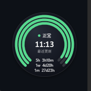
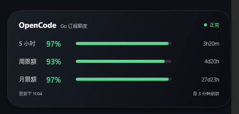
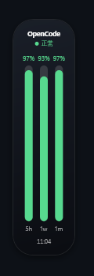

# OpenCode Meter for Windows

Windows 版的 OpenCode Go 额度悬浮球。和仓库里的 macOS WidgetKit 版共用同一套数据来源（本机 OpenCode 桌面服务），但交互形态换成了更适合 Windows 的桌面悬浮球。

## 功能

- **悬浮球**：三个同心进度环，从内到外分别是 5 小时 / 周 / 月额度。
- **底部缺口**：环的底部留出缺口，显示 `5h / 1w / 1m` 的下次重置倒计时。
- **中心信息**：最后一次成功刷新时间 + 当前状态（正常 / 已限流 / 离线 / 未连接 / 同步中）。
- **悬停展开**：鼠标停留约 220ms 后，球展开成 macOS 中号小组件风格的长条卡片，显示三档百分比、进度条、重置倒计时和刷新间隔。
- **拖动与吸附**：拖动球到屏幕左/右边缘（28px 内）自动吸附成竖条；竖条里是 5h / 1w / 1m 三根竖向进度条。
- **脱离边缘**：把竖条拖离边缘，或右键菜单选择「脱离边缘」，恢复成球。
- **右键菜单**：立即刷新、打开用量详情、剩余/已使用切换、刷新间隔、窗口置顶、脱离边缘、重置位置、打开数据目录、退出。
- **托盘式交互**：窗口不进入任务栏 / Alt-Tab；双击球或竖条打开 OpenCode 用量详情页。
- **设置持久化**：位置、悬浮球/吸附竖条模式、剩余/已使用、刷新间隔、置顶状态写入 `%LOCALAPPDATA%\OpenCodeMeter\settings.json`。

## 预览

| 悬浮球 | 悬停展开 |
| --- | --- |
|  |  |

| 边缘吸附竖条 |
| --- |
|  |

## 环境要求

- Windows 10 / 11
- 构建：.NET 9 SDK
- 运行：.NET 9 Desktop Runtime（或使用自包含发布）

## 构建与运行

```powershell
cd windows

dotnet build OpenCodeMeter.sln -c Release
dotnet run --project src\OpenCodeMeter.App
```

构建产物：

```text
src\OpenCodeMeter.App\bin\Release\net9.0-windows\OpenCodeMeter.exe
```

发布为单文件、自包含 exe：

```powershell
dotnet publish src\OpenCodeMeter.App -c Release -r win-x64 --self-contained true `
  -p:PublishSingleFile=true -p:IncludeNativeLibrariesForSelfExtract=true
```

产物在 `src\OpenCodeMeter.App\bin\Release\net9.0-windows\win-x64\publish\`。

## 数据来源

OpenCode 桌面端会写一个本机服务注册文件，里面包含随机端口和口令：

```text
~/.local/state/opencode/service.json
{
  "url": "http://127.0.0.1:28894",
  "password": "..."
}
```

应用会依次尝试：

1. 环境变量 `OPENCODE_SERVICE_FILE`
2. `%USERPROFILE%\.local\state\opencode\service.json`（Windows 上当前版本实际使用的位置）
3. `%USERPROFILE%\.config\opencode\service.json`
4. `%APPDATA%\opencode\service.json` / `%LOCALAPPDATA%\opencode\service.json`
5. `%APPDATA%\ai.opencode.desktop\service.json` / `%LOCALAPPDATA%\ai.opencode.desktop\service.json`

请求：

```http
GET {url}/api/experimental/usage/limits
Authorization: Basic base64("opencode:" + password)
```

返回的 `percent` 是已用百分比，界面默认显示 `100 - percent`。`resetsAt` 是毫秒时间戳。端口每次 OpenCode 重启都可能变化，所以每次刷新都会重新读注册文件。

## 交互说明

| 操作 | 效果 |
| --- | --- |
| 鼠标悬停悬浮球 | 展开成长条卡片 |
| 鼠标移开卡片 | 收回到悬浮球 |
| 按住拖动悬浮球 | 移动位置 |
| 拖到左/右边缘 28px 内 | 吸附成竖条 |
| 拖动竖条离开边缘 | 恢复成球并继续拖动 |
| 右键 | 打开菜单 |
| 双击 | 打开用量详情 |
| 悬停竖条 | 显示三档详细 tooltip |

## 代码结构

```text
windows/
├── OpenCodeMeter.sln
└── src/
    ├── OpenCodeMeter.Core/              # 与 UI 无关的核心逻辑
    │   ├── Models/                      # UsageSnapshot / UsageWindow / 错误类型
    │   ├── Services/
    │   │   ├── OpenCodeServiceLocator.cs
    │   │   ├── UsageClient.cs
    │   │   └── ResetFormatter.cs
    │   └── Settings/                    # settings.json 读写
    └── OpenCodeMeter.App/               # WPF 应用
        ├── MainWindow.xaml(.cs)         # 悬浮球 / 卡片 / 竖条 + 拖动吸附
        ├── Controls/
        │   ├── RingGauge.cs             # 同心圆环
        │   ├── HorizontalBar.cs         # 卡片横向进度条
        │   └── VerticalBar.cs           # 竖条竖向进度条
        ├── ViewModels/MainViewModel.cs
        ├── Services/MonitorService.cs   # 多显示器工作区 / 鼠标坐标 / 工具窗口
        └── App.xaml(.cs)                # 主题、菜单/tooltip 样式、单实例
```

## 与 macOS 版的差异

- macOS 版使用 WidgetKit 扩展和共享 `state.json`；Windows 版是单个常驻 WPF 进程，自己刷新并直接绘制界面。
- macOS 版的小组件由系统调度刷新；Windows 版由应用内定时器刷新（默认 3 分钟，可调 1–60 分钟）。
- Windows 版目前只支持左/右边缘吸附；拖到上/下边缘只会保持在球形态并限制在工作区内。

## 已知限制

- 依赖 OpenCode 桌面端正在运行；关闭后显示「离线」并保留上次数据。
- 仅支持左/右边缘吸附成竖条。
- 使用自签名/无签名构建，没有安装包和自动更新。
- 混合 DPI 多显示器环境下，极端情况可能需要重新拖动一次来校正位置。
